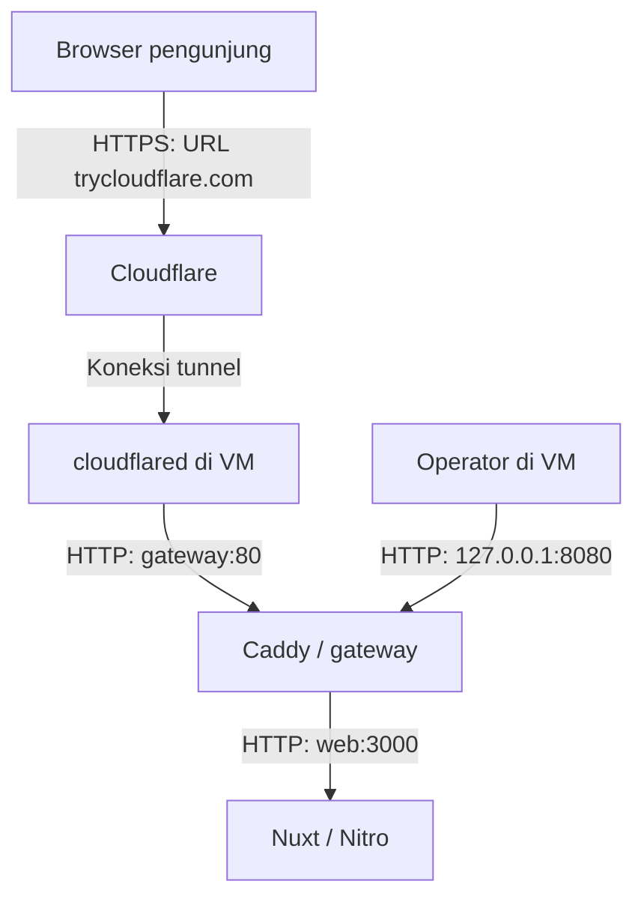
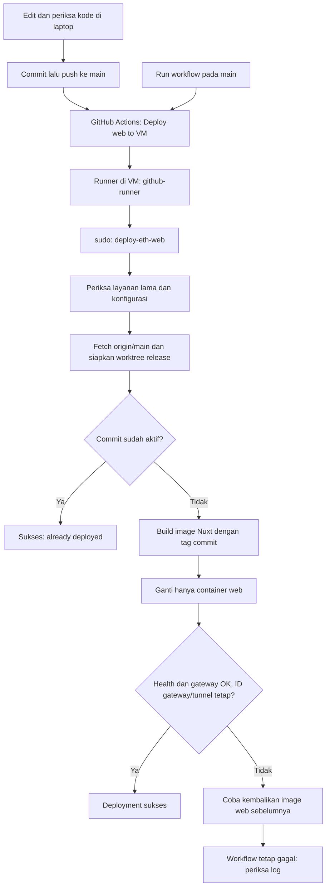

# Deployment VM: arsitektur, CI/CD, dan operasional

Panduan alur dari kode di laptop sampai website bisa dibuka pengunjung.
Terakhir diperbarui: **9 November 2026**.

Implementasi dijelaskan berdasarkan file repository. Status VM berdasarkan output
pengguna, bukan inspeksi langsung agent ke VM. Bagian **NEXT** adalah rencana,
**belum diterapkan**.

## 1. Kondisi sekarang

| Hal | Kondisi |
| --- | --- |
| Aplikasi aktif | Frontend Nuxt (`apps/web`), runtime Nitro |
| Backend NestJS | Ada di monorepo, belum termasuk deployment ini |
| VM | Ubuntu 24.04.2 LTS amd64, hostname `eth-apps` |
| Operator | User `ethapps` |
| IP lokal | `192.168.10.95`; akses IP publik belum dikonfirmasi |
| Repository | Private, `ETH-APPS/eth-web`, branch `main` |
| Checkout awal | `/opt/eth-web` |
| Auto-deploy | GitHub Actions, self-hosted runner di VM |
| Runner | `eth-apps-production`, label `eth-web-production` |
| User runner | `github-runner`, home `/opt/actions-runner` |
| Akses publik | Cloudflare Quick Tunnel, URL sementara |
| Gateway | Caddy, container `eth-web-gateway-1` |
| Port host aplikasi | Hanya `127.0.0.1:8080` menuju Caddy |

Snapshot terakhir dari output pengguna:

- Commit aktif terverifikasi oleh helper:
  `9dc1ff5832b0169da0ec235455015321823eac12` (`already deployed`).
  Image sesuai tag helper: `eth-web-web:9dc1ff5832b0`.
- URL terbaru: <https://runtime-keith-plaza-naval.trycloudflare.com>.
- URL itu merespons `HTTP/2 200` pada 6 November 2026 pukul 09.01 WIB.
  Setelah perbaikan deployment pada hari yang sama, pengguna kembali memastikan
  respons 200 dan perubahan halaman terbaru terlihat di browser.
- URL sebelumnya `https://dream-terrace-resolve-art.trycloudflare.com` sudah
  berganti. Log mengumumkan URL baru pada 4 November pukul 18.40 WIB.
- Ketiga container dilaporkan memiliki uptime sekitar 38 jam. Ini mengarah pada
  kemungkinan mereka sempat mulai ulang; penyebab pastinya belum diketahui.
- Investigasi berikutnya menemukan tiga run gagal saat fetch: koneksi
  `github.com:22` timeout. Koneksi dan autentikasi deploy key melalui
  `ssh.github.com:443` berhasil diuji pengguna. Helper repository dan salinan
  root-owned di VM sudah diperbarui memakai jalur 443. Fetch setelah pemasangan
  berhasil dan helper memastikan commit di atas sudah aktif.

### Insiden 6 November: dua masalah terpisah

1. **URL lama tidak bisa dibuka:** Quick Tunnel mengumumkan URL baru setelah
   prosesnya mulai ulang. Penyebab mulai ulang belum diketahui; perbaikan SSH
   tidak mengembalikan URL lama.
2. **Push belum terlihat di website:** fetch dari VM ke `github.com:22` timeout,
   sehingga deployment berhenti sebelum build dan penggantian web. Versi lama
   tetap berjalan. Penyebab jaringan spesifik (misalnya firewall atau jalur ISP)
   belum dibuktikan; deploy key berhasil ketika diuji lewat port 443.

Perbaikan yang sudah dilakukan:

- Ubah SSH helper menuju `ssh.github.com:443`, pertahankan pemeriksaan host key,
  dan beri timeout koneksi 15 detik.
- Commit/push `9dc1ff5`, pull di VM lewat SSH 443, validasi sintaks Bash, lalu
  pasang helper root-owned di `/usr/local/sbin/deploy-eth-web`.
- Percobaan manual sempat ditolak karena lock deployment sedang dipegang proses
  lain. Tidak ada lock yang dihapus atau proses yang dipaksa berhenti. Percobaan
  berikutnya berhasil fetch dan menghasilkan `already deployed`.
- Pengguna mengonfirmasi respons publik 200 dan pembaruan halaman di browser.

Tidak diperlukan perubahan `.env`, Caddy, atau Compose untuk memperbaiki fetch.
Status akhir run di halaman GitHub Actions belum dibagikan, tetapi commit aktif
dan akses website telah diverifikasi. Snapshot ini bukan jaminan bahwa setiap
push setelah commit tersebut sudah ter-deploy; tetap periksa run masing-masing.

## 2. Flow pengunjung: browser sampai aplikasi



Browser meminta halaman melalui Cloudflare. Request diteruskan lewat tunnel ke
Caddy, lalu Caddy meminta halaman dari Nuxt. Respons kembali melalui jalur itu.

| Komponen | Tugas dalam project ini |
| --- | --- |
| Nuxt / Nitro (`web`) | Menjalankan website hasil build dan melayani halaman/aset pada port 3000 internal Docker. |
| Caddy (`gateway`) | Reverse proxy: menerima request dan meneruskannya ke `web:3000`. Juga mengompresi respons dengan gzip/zstd. |
| `cloudflared` | Membuat koneksi keluar dari VM ke Cloudflare agar website bisa diakses tanpa membuka port masuk publik pada router. |
| Cloudflare | Menyediakan URL publik dan HTTPS bagi pengunjung. |
| Docker image | Paket aplikasi hasil build, diberi tag commit agar release bisa diidentifikasi. |
| Docker container | Proses yang menjalankan image di VM. |
| Docker Compose | Mendefinisikan service, jaringan, healthcheck, dan aturan restart. |

Saat ini Caddy menggunakan HTTP internal. HTTPS publik ditangani Cloudflare;
`auto_https off` di Caddyfile sesuai dengan arsitektur ini. Admin API Caddy
juga dimatikan. Kita belum menggunakan Nginx atau `sites-enabled`.

Nama `gateway` dan `web` dikenali melalui jaringan Docker `eth-web_default`.
Port 3000 tidak dipublikasikan ke host. Mapping `127.0.0.1:8080:80` membuat Caddy
bisa diperiksa dari VM, tetapi tidak langsung dari internet.

### Kenapa URL berubah walaupun hanya push?

Quick Tunnel menyediakan hostname acak sementara. Saat proses tunnel dijalankan
ulang dan membuat tunnel baru, alamat bisa berubah tanpa pengguna mengedit URL.
Contohnya setelah VM atau proses container mulai ulang.

Auto-deploy kita hanya mengganti `web`, sehingga secara normal tidak membuat
tunnel baru. Namun proses tunnel tetap dapat restart karena sebab lain.
Pemeriksaan ID container di script juga tidak membuktikan proses di dalam
container tidak pernah restart.

Jangan restart `cloudflared`, menjalankan `docker compose down`, atau recreate
seluruh stack untuk update frontend rutin. URL lama tidak dapat dipilih kembali
melalui konfigurasi Quick Tunnel kita. Domain tetap dibahas di bagian NEXT.

## 3. Flow kode: laptop, CI, dan CD



### CI: pemeriksaan kode

CI (Continuous Integration) biasanya menjalankan lint, typecheck, test, dan build
untuk memeriksa perubahan sebelum dirilis.

**Saat ini belum ada job CI terpisah untuk lint, typecheck, test, atau pemeriksaan
pull request.** Repository memiliki satu workflow deployment. Instalasi dependency
dengan lockfile dan build Nuxt dilakukan di dalam proses deployment itu. Build
sukses dan healthcheck `/` bukan bukti bahwa semua fitur aplikasi benar.

### CD: memasang release ke VM

CD (Continuous Deployment) memasang perubahan ke server secara otomatis. Workflow
[`deploy-web.yml`](../.github/workflows/deploy-web.yml) saat ini:

1. Terpicu oleh push ke `main`, atau `workflow_dispatch` pada `main`.
2. Memilih runner berlabel `self-hosted`, `Linux`, `X64`, `eth-web-production`.
3. Menjalankan `sudo -n /usr/local/sbin/deploy-eth-web`.
4. Membatasi waktu job menjadi 30 menit. Concurrency group `production-web`
   mencegah job deployment bersamaan; push baru tidak membatalkan job berjalan.

Workflow tidak memakai checkout action. Helper mengambil **main terbaru ketika
fetch berjalan**. Jika ada beberapa push berdekatan, SHA yang ter-deploy bisa
lebih baru daripada SHA pemicu job. Lihat SHA pada log untuk mengetahui release
sebenarnya.

### Apa yang dilakukan helper?

Implementasi: [`deploy-web.sh`](deploy-web.sh).

1. Memastikan repo, deploy key, known hosts, spec Compose, file site URL, dan
   jaringan tersedia. Mengambil lock agar helper tidak berjalan bersamaan.
2. Memastikan tepat satu container berjalan untuk masing-masing service `web`,
   `gateway`, dan `cloudflared`. Web lama harus healthy dan gateway harus merespons.
3. Mencatat image lama untuk rollback serta ID gateway/tunnel untuk pemeriksaan.
4. Fetch `origin/main` sebagai user `ethapps` dengan deploy key read-only.
5. Membuat worktree bersih di `/var/lib/eth-web-deploy/releases/<FULL_SHA>`.
6. Jika tag image aktif, label revisi, dan site URL container sudah sesuai,
   selesai: `already deployed`. Perubahan site URL tetap memicu recreate web
   walaupun commit sama.
7. Build image `eth-web-web:<SHORT_SHA>` dari worktree tersebut, atau gunakan
   ulang image tervalidasi bila hanya konfigurasi site URL yang berubah. Web lama
   tetap berjalan selama build.
8. Menggunakan spec web-only untuk `up --detach --no-build --no-deps web`.
9. Menunggu web healthy, menguji gateway, dan memastikan ID gateway/tunnel tetap.
10. Jika gagal setelah penggantian dimulai, mencoba mengembalikan image lama.
    Workflow tetap gagal meskipun rollback berhasil agar masalah terlihat.

**Batasan:** pergantian satu container web dapat menyebabkan jeda singkat. Ini
belum deployment tanpa downtime. Rollback otomatis ada di script, tetapi simulasi
kegagalan/rollback belum terverifikasi. Jika web lama unhealthy, preflight berhenti
sebelum build; helper bukan alat pemulihan universal.

Checkout `/opt/eth-web` tidak otomatis berpindah HEAD pada deployment. Helper
fetch lalu membangun worktree terpisah. `git log -1` pada checkout awal tidak
cukup untuk mengetahui versi aplikasi yang sedang berjalan.

## 4. File, akun, dan environment

| File sumber | Kegunaan / lokasi operasional |
| --- | --- |
| [`apps/web/Dockerfile`](../apps/web/Dockerfile) | Build Node 24 + pnpm; runtime hanya membawa `.output` dan berjalan sebagai user `node`. |
| [`compose.yaml`](../compose.yaml) | Stack lengkap untuk bootstrap: web, gateway, cloudflared. Bukan jalur update frontend rutin. |
| [`deploy/Caddyfile`](Caddyfile) | Dipasang dari `/opt/eth-web/deploy/Caddyfile` ke `/etc/caddy/Caddyfile` di container. |
| [`deploy/web.compose.yaml`](web.compose.yaml) | Spec web-only, disalin root-owned ke `/etc/eth-web/web.compose.yaml`. |
| [`deploy/deploy-web.sh`](deploy-web.sh) | Helper, disalin root-owned ke `/usr/local/sbin/deploy-eth-web`. |
| [`deploy/github-runner.sudoers`](github-runner.sudoers) | Disalin ke `/etc/sudoers.d/github-runner-deploy-eth-web`. |
| `/etc/eth-web/site-url` | File root-owned di VM berisi satu origin HTTPS untuk `NUXT_PUBLIC_SITE_URL`; bukan file repository. |
| [Workflow Actions](../.github/workflows/deploy-web.yml) | Trigger dan job deployment. |
| [`.dockerignore`](../.dockerignore) | Mengecualikan dependency lokal, cache, output build, dan `.env` aktual dari build context. |

Runner berjalan sebagai `github-runner` dan tidak diberi grup Docker. Sudoers hanya
mengizinkan helper root-owned tanpa argumen. Helper menjalankan Docker sebagai
root; jangan memberi runner sudo umum untuk mengatasi error.

Git dijalankan sebagai `ethapps` memakai `/home/ethapps/.ssh/eth-web-deploy`.
Helper menggunakan SSH ke `ssh.github.com:443`, dengan `HostKeyAlias=github.com`
agar tetap memverifikasi host key GitHub yang sudah dipercaya di `known_hosts`.
`StrictHostKeyChecking=yes` tetap aktif dan timeout koneksi ditetapkan 15 detik.
Public key terdaftar sebagai deploy key read-only. Jangan membagikan private key,
token runner, atau secret. Akses push ke `main` harus dibatasi pada pihak tepercaya
karena kode yang di-push akan dibangun dan dijalankan di VM.

Perubahan script/spec/sudoers di repository **tidak otomatis memperbarui salinan
root-owned di VM**. Perlu pemasangan terpisah oleh operator setelah memeriksa diff
serta memvalidasi sudoers. Push frontend biasa tidak memerlukan langkah itu.

### Apakah `.env` lokal otomatis ikut?

Tidak. Dockerfile menetapkan `NODE_ENV`, `NITRO_HOST`, dan `NITRO_PORT`.
Helper memakai environment bersih dan `--env-file /dev/null`, sehingga tidak
mengandalkan `.env` implisit Compose. `.env` lokal aktual dikecualikan dari build.

Untuk schema SEO, helper membaca satu origin HTTPS dari file root-owned
`/etc/eth-web/site-url`, memvalidasinya, lalu meneruskan nilainya secara eksplisit
sebagai `NUXT_PUBLIC_SITE_URL` ke spec web-only. Compose bootstrap menerima
variabel shell dengan nama yang sama dan memakai nilai kosong jika tidak diisi.
Nilai site URL bersifat publik, tetapi file tetap root-owned untuk mencegah
perubahan konfigurasi deployment oleh user yang tidak berwenang.

Jika fitur baru membutuhkan konfigurasi, tentukan apakah digunakan saat build
atau runtime, serta apakah boleh terlihat browser atau harus server-side. Tambah
mekanisme deployment yang sesuai; jangan menganggap menambah `.env` lokal lalu
push sudah memasang nilainya di VM. Pergantian URL pada insiden November belum
membuktikan adanya error `.env`.

### Menyiapkan atau mengganti site URL schema

Gunakan **origin saja**: skema, hostname, dan port opsional. Jangan menyertakan
path, query, fragment, atau slash penutup. Untuk Quick Tunnel aktif saat dokumen
ini diperbarui, nilainya:

```text
https://runtime-keith-plaza-naval.trycloudflare.com
```

Operator memasang nilai tersebut di VM, bukan memasukkannya ke Git:

```bash
printf '%s\n' 'https://runtime-keith-plaza-naval.trycloudflare.com' | sudo tee /etc/eth-web/site-url >/dev/null
sudo chown root:root /etc/eth-web/site-url
sudo chmod 0644 /etc/eth-web/site-url
```

Sebelum menjalankan helper versi baru pertama kali, pasang juga salinan spec dan
helper root-owned setelah memeriksa diff:

```bash
sudo install -o root -g root -m 0644 deploy/web.compose.yaml /etc/eth-web/web.compose.yaml
sudo install -o root -g root -m 0755 deploy/deploy-web.sh /usr/local/sbin/deploy-eth-web
sudo bash -n /usr/local/sbin/deploy-eth-web
```

Run workflow berikutnya akan meneruskan nilai itu ke container web. Jika hanya
site URL yang berubah dan commit sama, helper menggunakan ulang image yang sudah
ada lalu mengganti **hanya** container web. Gateway dan cloudflared tidak
direstart atau dibuat ulang.

Untuk bootstrap stack dari repository, berikan variabel secara eksplisit:

```bash
NUXT_PUBLIC_SITE_URL='https://runtime-keith-plaza-naval.trycloudflare.com' docker compose up --detach
```

Quick Tunnel dapat berganti setelah proses tunnel restart. Ketika URL berubah,
perbarui `/etc/eth-web/site-url` dan jalankan ulang workflow. Setelah domain final
tersedia, ganti file dengan origin final. Jangan hardcode URL sementara ke source
aplikasi atau Compose.

Setelah deploy, verifikasi bahwa konfigurasi dan schema benar-benar aktif:

```bash
sudo docker inspect --format '{{range .Config.Env}}{{println .}}{{end}}' eth-web-web-1 | grep '^NUXT_PUBLIC_SITE_URL='
curl --fail --silent --show-error http://127.0.0.1:8080/ | grep -F '"@type":"WebSite"'
curl --fail --silent --show-error http://127.0.0.1:8080/blog | grep -F '"@type":"CollectionPage"'
curl --fail --silent --show-error http://127.0.0.1:8080/sitemap.xml
curl --fail --silent --show-error http://127.0.0.1:8080/robots.txt
```

Lanjutkan dengan memeriksa URL publik. URL schema dan gambar harus memakai origin
yang sama dengan site URL. HTTP 200 saja belum membuktikan schema sudah benar.

## 5. Penggunaan sehari-hari

Untuk perubahan frontend biasa:

1. Periksa perubahan di laptop, commit file yang ingin dirilis, push ke `main`.
2. Buka GitHub → repository → **Actions → Deploy web to VM**.
3. Pastikan run selesai sukses dan lihat SHA/image pada log.
4. Buka website dan periksa halaman/fitur yang diubah.

Tidak perlu SSH, pull manual, atau restart pada setiap push. `already deployed`
adalah hasil sukses jika release yang sama sudah aktif. Status job yang masih
antre atau berputar belum selesai hanya karena ada satu baris log sukses.

Untuk mengulang deployment, gunakan **Run workflow** pada `main`. Ini tetap
mengambil main terbaru, bukan cara memilih release lama untuk rollback.

## 6. Pemeriksaan operasional di terminal VM

Perintah berikut hanya membaca status/log; tidak me-restart container. Jalankan
sebagai `ethapps` di VM, bukan terminal laptop yang belum terhubung SSH.

Status semua service tanpa perlu menebak tag image:

```bash
sudo docker ps --all --filter label=com.docker.compose.project=eth-web --format 'table {{.Names}}\t{{.Image}}\t{{.Status}}\t{{.Ports}}'
```

Uji gateway lokal:

```bash
curl -I --max-time 20 http://127.0.0.1:8080/
```

Cari pengumuman URL tunnel; pola ini menghindari URL pada log request error:

```bash
sudo docker logs eth-web-cloudflared-1 2>&1 | grep -E 'INF.*https://[a-z0-9-]+\.trycloudflare\.com' | tail -n 5
```

Uji URL terbaru yang ditemukan. Contoh sesuai snapshot 6 November:

```bash
curl -I --max-time 20 https://runtime-keith-plaza-naval.trycloudflare.com/
```

Image aktif, waktu mulai, dan jumlah restart container:

```bash
sudo docker inspect --format '{{.Name}} image={{.Config.Image}} started={{.State.StartedAt}} restarts={{.RestartCount}}' eth-web-web-1 eth-web-gateway-1 eth-web-cloudflared-1
```

Data restart adalah petunjuk, bukan bukti lengkap penyebabnya. Recreate container
juga bisa menghilangkan riwayat container sebelumnya.

Periksa runner bila job antre:

```bash
sudo systemctl status actions.runner.ETH-APPS-eth-web.eth-apps-production.service --no-pager -l
```

Ambil log terbatas sesuai service yang bermasalah:

```bash
sudo docker logs --tail 100 eth-web-web-1
sudo docker logs --tail 100 eth-web-gateway-1
sudo docker logs --tail 100 eth-web-cloudflared-1
```

Periksa dan redaksi secret sebelum membagikan log. Jangan kirim isi `.env`.

| Gejala | Pemeriksaan berikutnya |
| --- | --- |
| URL lama gagal, gateway lokal berhasil | Cari dan uji URL tunnel terbaru. |
| URL terbaru gagal, gateway lokal berhasil | Periksa log dan koneksi cloudflared. |
| Gateway lokal gagal | Periksa health/status web dan log web/gateway. |
| Push belum terlihat | Periksa run Actions dan image aktif. |
| Actions antre | Periksa runner di GitHub dan service runner di VM. |
| Actions gagal | Baca error yang relevan, jangan langsung restart stack. |
| Build gagal karena disk penuh | Periksa `df -h` dan `sudo docker system df`; tentukan release rollback sebelum menghapus data. |

Respons `200` hanya membuktikan endpoint yang diuji merespons. Tetap periksa fitur
di browser, terutama setelah perubahan konfigurasi atau integrasi API.

## 7. NEXT — domain sendiri (belum diterapkan)

**Ini rencana. Pembaruan dokumentasi tidak mengubah DNS, port, Caddy, atau tunnel.**

Domain adalah alamat pengunjung. Tunnel adalah salah satu jalur menuju VM.
Domain sendiri dapat dipakai dengan ataupun tanpa tunnel.

### Pilihan A: domain langsung ke Caddy, tanpa tunnel

```text
Browser → HTTPS domain sendiri → IP publik/router → Caddy → Nuxt
```

Sesuai jika jaringan dapat menerima koneksi masuk dari internet dan operator
memiliki kendali atas konfigurasi jaringan. Rencana langkahnya:

1. Konfirmasi IP publik, NAT/CGNAT, kendali router, serta akses port 80/443.
2. Arahkan DNS ke IP publik. Jika VM di belakang router, atur port forwarding
   dan firewall menuju VM.
3. Sesuaikan port Compose gateway serta Caddyfile untuk domain dan automatic HTTPS.
   Konfigurasi sekarang (`127.0.0.1:8080`, `:80`, `auto_https off`) belum siap.
4. Tambahkan penyimpanan persisten Caddy, umumnya `/data` dan `/config`, agar
   data sertifikat/konfigurasi tetap ada saat container dibuat ulang.
5. **Sesuaikan helper deployment sebelum menghapus tunnel.** Saat ini helper
   mewajibkan cloudflared berjalan dan memeriksa gateway melalui
   `http://127.0.0.1:8080/`. Tentukan pemeriksaan baru yang sesuai arsitektur domain.
6. Uji HTTPS, renewal sertifikat, akses publik, dan auto-deploy. Hentikan tunnel
   lama setelah jalur domain terverifikasi.

Caddy dapat mengurus penerbitan dan perpanjangan sertifikat otomatis. Tidak perlu
beralih ke Nginx hanya untuk domain. `sites-available`/`sites-enabled` adalah pola
konfigurasi Nginx pada Ubuntu, bukan syarat menggunakan domain.

### Pilihan B: domain sendiri melalui Named Cloudflare Tunnel

```text
Browser → HTTPS domain sendiri → Cloudflare → Named Tunnel → Caddy → Nuxt
```

Sesuai jika VM berada di jaringan lokal tanpa akses masuk publik. Rencananya:

1. Siapkan domain pada Cloudflare dan buat named tunnel yang dikelola tetap.
2. Simpan kredensial/token tunnel di VM melalui mekanisme secret yang sesuai,
   bukan Git atau dokumentasi.
3. Hubungkan hostname domain ke service `http://gateway:80`.
4. Ganti Quick Tunnel dengan named tunnel dalam perubahan terencana.
5. Pertahankan kontrak service `cloudflared` atau sesuaikan helper bila nama/topologi
   berubah. Uji domain, restart terencana, dan auto-deploy setelah migrasi.

Hostname domain tetap dikonfigurasi meskipun proses tunnel restart. Akses masih
bisa terputus selama restart; alamat tetap bukan jaminan server selalu online.
Caddy dapat tetap menggunakan HTTP internal pada pilihan ini.

**Belum diputuskan:** domain, pengelola DNS, serta apakah VM punya akses IP publik
atau port forwarding. IP lokal `192.168.10.95` tidak bisa langsung dijadikan
alamat tujuan website publik dari internet.

Referensi resmi:

- [Caddy: HTTPS quick-start](https://caddyserver.com/docs/quick-starts/https)
- [Cloudflare: setup tunnel](https://developers.cloudflare.com/tunnel/get-started/)
- [Ubuntu: konfigurasi Nginx](https://ubuntu.com/server/docs/how-to/web-services/configure-nginx/)

## 8. NEXT — CI/CD dan operasional (belum diterapkan)

- Tambahkan CI relevan (lint/typecheck/test/build) untuk pull request dan jadikan
  hasilnya syarat merge/deploy. Jalankan pemeriksaan kode PR di lingkungan terpisah
  dari runner produksi.
- Uji kegagalan deploy dan rollback secara terencana. Pertimbangkan dua instance
  dan pengalihan traffic bila perlu mengurangi jeda release.
- Tentukan retensi image/worktree; helper belum membersihkannya otomatis.
- Pin versi/digest dan jadwalkan pembaruan image. Saat ini masih memakai tag
  `node:24-slim`, `caddy:2`, dan `cloudflare/cloudflared:latest`.
- Tambahkan monitoring dan uji pemulihan/reboot setelah alamat stabil tersedia.
  `restart: unless-stopped` membantu restart, tetapi bukan jaminan uptime.
- Rancang deployment API, healthcheck, konfigurasi, database/migrasi, dan backup
  saat backend siap. Backend belum termasuk flow request maupun deployment ini.

## 9. Handoff untuk agent/operator berikutnya

- Baca workflow, helper, dan spec sebelum memberi command; cocokkan salinan
  root-owned di VM jika perilaku tidak sesuai repository.
- Bedakan output VM, konfigurasi repository, dan rencana NEXT.
- Berikan satu langkah VM per giliran saat pengguna menjalankan command manual;
  jelaskan apakah membaca status atau mengubah layanan.
- Jangan gunakan prosedur lama full-stack `compose up -d` untuk update frontend
  rutin. Jangan hentikan tunnel untuk diagnosis yang penyebabnya belum jelas.
- Push tidak otomatis memperbarui `.env`, salinan root-owned, atau HEAD checkout awal.
- URL merespons 200 tidak membuktikan commit terbaru sudah ter-deploy.
- Jangan membagikan secret atau melakukan full system upgrade sebagai langkah
  troubleshooting otomatis.
- Perbaikan SSH 443 sudah dipasang di VM dan commit `9dc1ff5` terverifikasi aktif.
  Penyebab awal timeout port 22 dan penyebab tunnel mulai ulang belum diketahui.
- Untuk perubahan helper berikutnya, ingat bahwa push saja tidak memperbarui
  salinan root-owned. Jangan restart gateway/tunnel untuk perbaikan jalur Git.
