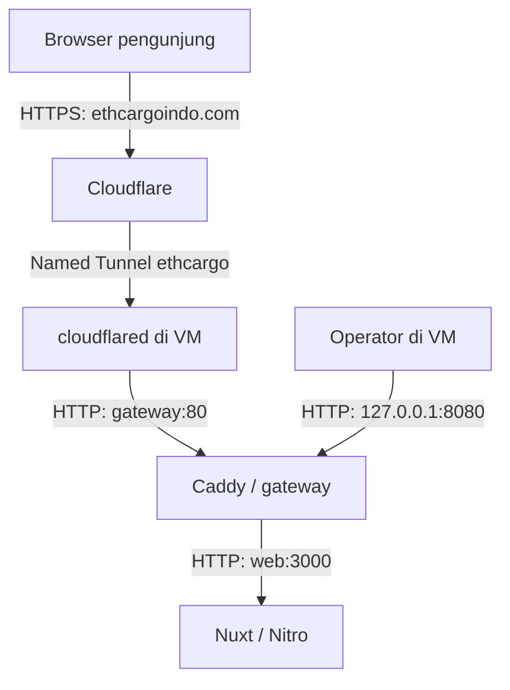
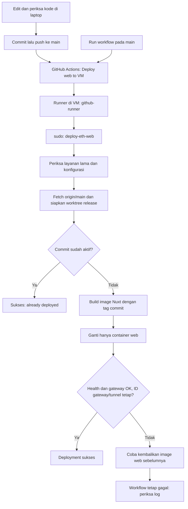

# Deployment VM: arsitektur, CI/CD, dan operasional

Panduan alur dari kode di laptop sampai website bisa dibuka pengunjung.
Untuk penjelasan yang lebih sederhana, baca [alur akses website](../docs/alur-akses-website.md).

Terakhir diperbarui: **25 November 2026**.

Implementasi dijelaskan berdasarkan file repository. Status VM berdasarkan output
pengguna, bukan inspeksi langsung agent ke VM. Perubahan helper untuk melepas
Quick Tunnel di repository **belum dipasang di VM**.

## 1. Kondisi sekarang

| Hal | Kondisi |
| --- | --- |
| Aplikasi aktif | Frontend Nuxt (`apps/web`), runtime Nitro |
| Backend NestJS | Ada di monorepo, belum termasuk deployment ini |
| VM | Ubuntu 24.04.2 LTS amd64, hostname `eth-apps` |
| Operator | User `ethapps` |
| IP lokal | `192.168.10.95`, di belakang router `192.168.10.1` |
| Repository | Private, `ETH-APPS/eth-web`, branch `main` |
| Checkout awal | `/opt/eth-web` |
| Auto-deploy | GitHub Actions, self-hosted runner di VM |
| Runner | `eth-apps-production`, label `eth-web-production` |
| User runner | `github-runner`, home `/opt/actions-runner` |
| Akses publik | `ethcargoindo.com` dan `www` melalui Named Tunnel `ethcargo` |
| Gateway | Caddy, container `eth-web-gateway-1` |
| Port host aplikasi | Hanya `127.0.0.1:8080` menuju Caddy |

### Status 25 November: cutover domain

Operator menjalankan Named Tunnel sebagai proyek Compose terpisah
`eth-web-named-tunnel`. Route `ethcargoindo.com`, `www.ethcargoindo.com`, dan
`revamp-preview.ethcargoindo.com` menuju `http://gateway:80`. Record DNS apex
diubah dari A `128.199.180.74` menjadi CNAME ke tunnel `ethcargo`; `www`
tetap CNAME ke apex dan redirect ke apex. Record `api`, `member`, dan `cdn`
tidak diubah. Kedua hostname utama mengembalikan `{"status":"ok"}` dari
`/api/health`, dan operator melihat web revamp di browser.

`/etc/eth-web/site-url` sekarang berisi `https://ethcargoindo.com`. Web aktif
memakai image `eth-web-web:a6afd5038350` dan healthy menurut output operator.
Quick Tunnel lama masih berjalan karena helper root-owned yang terpasang di VM
masih memeriksanya. Jangan hentikan Quick Tunnel sebelum helper baru dipasang
dan diuji.

### Status 23 November: secret produk Ducking dan push

Berdasarkan output terminal yang dibagikan operator, file
`/etc/eth-web/ducking-signing-secret` sudah dibuat dengan owner `root:root` dan
mode `600`. Salinan `deploy-web.sh` dan `web.compose.yaml` terbaru dipindahkan
ke VM, diverifikasi checksum dan sintaks/Compose, lalu dipasang ke lokasi
root-owned; operator melaporkan hasil `Helper dan Compose: terpasang`.
Pengguna kemudian melaporkan sudah push `main`; checkout lokal menunjuk commit
`20f7e36`. **Hasil GitHub Action, image aktif, dan smoke test produk di VM belum
dibagikan**, sehingga status deploy fitur belum dinyatakan terverifikasi.
Alur request dan pemeriksaan fitur ada di
[alur produk Ducking](../docs/ducking-product-flow.md).

### Status 10 November: konfigurasi origin SEO di VM

Berdasarkan output terminal yang dibagikan pengguna, image web yang aktif sudah
berasal dari commit `c02c78ce3aa720331abcb6c72d8f7da62b34538e`, tetapi
checkout `/opt/eth-web` masih di commit `9dc1ff5`. Ini normal untuk helper yang
membangun dari worktree release terpisah; checkout awal bukan penentu versi web
aktif. Pada saat pemeriksaan awal, `/etc/eth-web/site-url` belum ada dan salinan
root-owned helper/Compose belum memuat `NUXT_PUBLIC_SITE_URL`, sehingga HTML
publik belum memiliki schema dan canonical.

Operator kemudian membuat `/etc/eth-web/site-url` berisi origin Quick Tunnel
aktif, dengan kepemilikan `root:root` dan mode `644`. Setelah membandingkan diff,
operator memasang `web.compose.yaml` dan `deploy-web.sh` dari worktree release
`c02c78c` ke lokasi root-owned masing-masing. `sudo bash -n` lolos.
`sudo /usr/local/sbin/deploy-eth-web` menggunakan ulang image
`eth-web-web:c02c78ce3aa7` dan mengganti hanya container web; helper melaporkan
gateway dan cloudflared tetap berjalan. Tidak ada perubahan Caddy atau konfigurasi
tunnel.

Pemeriksaan `docker inspect` menunjukkan `NUXT_PUBLIC_SITE_URL` sudah masuk ke
container. Homepage melalui Caddy lokal dan Quick Tunnel sama-sama mengandung
JSON-LD `WebSite` pada HTML awal; canonical homepage juga muncul pada HTML
publik. Respons publik masih mengirim `X-Robots-Tag: none`, sedangkan respons
Caddy lokal tidak. Asal header setelah Caddy belum dipastikan. Ini masih URL
sementara untuk validasi; domain final, sitemap, robots, dan schema halaman lain
belum diverifikasi ulang setelah deploy. Rincian SEO ada di
[progres SEO](../docs/seo/progress.md).

Snapshot sebelumnya, sampai 6 November, untuk riwayat:

- Commit aktif terverifikasi oleh helper:
  `9dc1ff5832b0169da0ec235455015321823eac12` (`already deployed`).
  Image sesuai tag helper: `eth-web-web:9dc1ff5832b0`.
- URL terbaru: <https://runtime-keith-plaza-naval.trycloudflare.com>.
- URL itu merespons `HTTP/2 200` pada 6 November 2026 pukul 09.01 WIB.
  Setelah perbaikan deployment pada hari yang sama, pengguna kembali memastikan
  respons 200 dan perubahan halaman terbaru terlihat di browser.
- URL sebelumnya `https://dream-terrace-resolve-art.trycloudflare.com` sudah
  berganti. Log mengumumkan URL baru pada 4 November pukul 18.40 WIB.
- Ketiga container dilaporkan memiliki uptime sekitar 38 jam. Ini mengarah pada
  kemungkinan mereka sempat mulai ulang; penyebab pastinya belum diketahui.
- Investigasi berikutnya menemukan tiga run gagal saat fetch: koneksi
  `github.com:22` timeout. Koneksi dan autentikasi deploy key melalui
  `ssh.github.com:443` berhasil diuji pengguna. Helper repository dan salinan
  root-owned di VM sudah diperbarui memakai jalur 443. Fetch setelah pemasangan
  berhasil dan helper memastikan commit di atas sudah aktif.

### Insiden 6 November: dua masalah terpisah

1. **URL lama tidak bisa dibuka:** Quick Tunnel mengumumkan URL baru setelah
   prosesnya mulai ulang. Penyebab mulai ulang belum diketahui; perbaikan SSH
   tidak mengembalikan URL lama.
2. **Push belum terlihat di website:** fetch dari VM ke `github.com:22` timeout,
   sehingga deployment berhenti sebelum build dan penggantian web. Versi lama
   tetap berjalan. Penyebab jaringan spesifik (misalnya firewall atau jalur ISP)
   belum dibuktikan; deploy key berhasil ketika diuji lewat port 443.

Perbaikan yang sudah dilakukan:

- Ubah SSH helper menuju `ssh.github.com:443`, pertahankan pemeriksaan host key,
  dan beri timeout koneksi 15 detik.
- Commit/push `9dc1ff5`, pull di VM lewat SSH 443, validasi sintaks Bash, lalu
  pasang helper root-owned di `/usr/local/sbin/deploy-eth-web`.
- Percobaan manual sempat ditolak karena lock deployment sedang dipegang proses
  lain. Tidak ada lock yang dihapus atau proses yang dipaksa berhenti. Percobaan
  berikutnya berhasil fetch dan menghasilkan `already deployed`.
- Pengguna mengonfirmasi respons publik 200 dan pembaruan halaman di browser.

Tidak diperlukan perubahan `.env`, Caddy, atau Compose untuk memperbaiki fetch.
Status akhir run di halaman GitHub Actions belum dibagikan, tetapi commit aktif
dan akses website telah diverifikasi. Snapshot ini bukan jaminan bahwa setiap
push setelah commit tersebut sudah ter-deploy; tetap periksa run masing-masing.

## 2. Flow pengunjung: browser sampai aplikasi



Browser meminta halaman melalui Cloudflare. Request diteruskan lewat tunnel ke
Caddy, lalu Caddy meminta halaman dari Nuxt. Respons kembali melalui jalur itu.

| Komponen | Tugas dalam project ini |
| --- | --- |
| Nuxt / Nitro (`web`) | Menjalankan website hasil build dan melayani halaman/aset pada port 3000 internal Docker. |
| Caddy (`gateway`) | Reverse proxy: menerima request dan meneruskannya ke `web:3000`. Juga mengompresi respons dengan gzip/zstd. |
| `cloudflared` | Membuat koneksi keluar dari VM ke Cloudflare agar website bisa diakses tanpa membuka port masuk publik pada router. |
| Cloudflare | Menyediakan URL publik dan HTTPS bagi pengunjung. |
| Docker image | Paket aplikasi hasil build, diberi tag commit agar release bisa diidentifikasi. |
| Docker container | Proses yang menjalankan image di VM. |
| Docker Compose | Mendefinisikan service, jaringan, healthcheck, dan aturan restart. |

Saat ini Caddy menggunakan HTTP internal. HTTPS publik ditangani Cloudflare;
`auto_https off` di Caddyfile sesuai dengan arsitektur ini. Admin API Caddy
juga dimatikan. Kita belum menggunakan Nginx atau `sites-enabled`.

Nama `gateway` dan `web` dikenali melalui jaringan Docker `eth-web_default`.
Port 3000 tidak dipublikasikan ke host. Mapping `127.0.0.1:8080:80` membuat Caddy
bisa diperiksa dari VM, tetapi tidak langsung dari internet.

Named Tunnel mempertahankan hostname saat proses `cloudflared` mulai ulang.
Auto-deploy hanya mengganti `web`; pemeriksaan ID container di helper memastikan
gateway dan container Named Tunnel tidak dibuat ulang selama deploy. Pemeriksaan
itu tidak membuktikan koneksi tunnel ke Cloudflare selalu sehat. Untuk update
frontend rutin, jangan jalankan `docker compose down` atau recreate seluruh
stack.

## 3. Flow kode: laptop, CI, dan CD



### CI: pemeriksaan kode

CI (Continuous Integration) biasanya menjalankan lint, typecheck, test, dan build
untuk memeriksa perubahan sebelum dirilis.

**Saat ini belum ada job CI terpisah untuk lint, typecheck, test, atau pemeriksaan
pull request.** Repository memiliki satu workflow deployment. Instalasi dependency
dengan lockfile dan build Nuxt dilakukan di dalam proses deployment itu. Build
sukses dan healthcheck `/api/health` bukan bukti bahwa semua fitur aplikasi benar.

### CD: memasang release ke VM

CD (Continuous Deployment) memasang perubahan ke server secara otomatis. Workflow
[`deploy-web.yml`](../.github/workflows/deploy-web.yml) saat ini:

1. Terpicu oleh push ke `main`, atau `workflow_dispatch` pada `main`.
2. Memilih runner berlabel `self-hosted`, `Linux`, `X64`, `eth-web-production`.
3. Menjalankan `sudo -n /usr/local/sbin/deploy-eth-web`.
4. Membatasi waktu job menjadi 30 menit. Concurrency group `production-web`
   mencegah job deployment bersamaan; push baru tidak membatalkan job berjalan.

Workflow tidak memakai checkout action. Helper mengambil **main terbaru ketika
fetch berjalan**. Jika ada beberapa push berdekatan, SHA yang ter-deploy bisa
lebih baru daripada SHA pemicu job. Lihat SHA pada log untuk mengetahui release
sebenarnya.

### Apa yang dilakukan helper?

Implementasi: [`deploy-web.sh`](deploy-web.sh).

1. Memastikan repo, deploy key, known hosts, spec Compose, file site URL,
   file secret Ducking, dan jaringan tersedia. Mengambil lock agar helper tidak
   berjalan bersamaan.
2. Memastikan tepat satu container `web` dan `gateway` di proyek `eth-web`, serta
   `cloudflared` di proyek `eth-web-named-tunnel`. Web lama harus healthy dan
   gateway harus merespons.
3. Mencatat image lama untuk rollback serta ID gateway/tunnel untuk pemeriksaan.
4. Fetch `origin/main` sebagai user `ethapps` dengan deploy key read-only.
5. Membuat worktree bersih di `/var/lib/eth-web-deploy/releases/<FULL_SHA>`.
6. Jika tag image aktif, label revisi, site URL, dan secret Ducking container
   sudah sesuai, selesai: `already deployed`. Perubahan konfigurasi runtime
   tetap memicu recreate web walaupun commit sama.
7. Build image `eth-web-web:<SHORT_SHA>` dari worktree tersebut, atau gunakan
   ulang image tervalidasi bila hanya konfigurasi runtime yang berubah. Web lama
   tetap berjalan selama build.
8. Menggunakan spec web-only untuk `up --detach --no-build --no-deps web`.
9. Menunggu web healthy, menguji gateway, dan memastikan ID gateway/tunnel tetap.
10. Jika gagal setelah penggantian dimulai, mencoba mengembalikan image lama.
    Workflow tetap gagal meskipun rollback berhasil agar masalah terlihat.

**Batasan:** pergantian satu container web dapat menyebabkan jeda singkat. Ini
belum deployment tanpa downtime. Rollback otomatis ada di script, tetapi simulasi
kegagalan/rollback belum terverifikasi. Jika web lama unhealthy, preflight berhenti
sebelum build; helper bukan alat pemulihan universal.

Checkout `/opt/eth-web` tidak otomatis berpindah HEAD pada deployment. Helper
fetch lalu membangun worktree terpisah. `git log -1` pada checkout awal tidak
cukup untuk mengetahui versi aplikasi yang sedang berjalan.

## 4. File, akun, dan environment

| File sumber | Kegunaan / lokasi operasional |
| --- | --- |
| [`apps/web/Dockerfile`](../apps/web/Dockerfile) | Build Node 24 + pnpm; runtime hanya membawa `.output` dan berjalan sebagai user `node`. |
| [`compose.yaml`](../compose.yaml) | Stack web dan gateway untuk bootstrap. Bukan jalur update frontend rutin. |
| [`deploy/named-tunnel.compose.yaml`](named-tunnel.compose.yaml) | Named Tunnel dalam proyek Compose terpisah; salinan root-owned di `/etc/eth-web/named-tunnel.compose.yaml`. |
| [`deploy/Caddyfile`](Caddyfile) | Dipasang dari `/opt/eth-web/deploy/Caddyfile` ke `/etc/caddy/Caddyfile` di container. |
| [`deploy/web.compose.yaml`](web.compose.yaml) | Spec web-only, disalin root-owned ke `/etc/eth-web/web.compose.yaml`. |
| [`deploy/deploy-web.sh`](deploy-web.sh) | Helper, disalin root-owned ke `/usr/local/sbin/deploy-eth-web`. |
| [`deploy/github-runner.sudoers`](github-runner.sudoers) | Disalin ke `/etc/sudoers.d/github-runner-deploy-eth-web`. |
| `/etc/eth-web/site-url` | File root-owned di VM berisi satu origin HTTPS untuk `NUXT_PUBLIC_SITE_URL`; bukan file repository. |
| `/etc/eth-web/ducking-signing-secret` | File root-owned mode 0600 di VM berisi signing secret Ducking satu baris; bukan file repository. |
| `/etc/eth-web/ethcargo-tunnel-token` | Token Named Tunnel di VM saja, owner `root:65532`, mode `0440`; jangan tampilkan atau masukkan Git. |
| [Workflow Actions](../.github/workflows/deploy-web.yml) | Trigger dan job deployment. |
| [`.dockerignore`](../.dockerignore) | Mengecualikan dependency lokal, cache, output build, dan `.env` aktual dari build context. |

Runner berjalan sebagai `github-runner` dan tidak diberi grup Docker. Sudoers hanya
mengizinkan helper root-owned tanpa argumen. Helper menjalankan Docker sebagai
root; jangan memberi runner sudo umum untuk mengatasi error.

Git dijalankan sebagai `ethapps` memakai `/home/ethapps/.ssh/eth-web-deploy`.
Helper menggunakan SSH ke `ssh.github.com:443`, dengan `HostKeyAlias=github.com`
agar tetap memverifikasi host key GitHub yang sudah dipercaya di `known_hosts`.
`StrictHostKeyChecking=yes` tetap aktif dan timeout koneksi ditetapkan 15 detik.
Public key terdaftar sebagai deploy key read-only. Jangan membagikan private key,
token runner, atau secret. Akses push ke `main` harus dibatasi pada pihak tepercaya
karena kode yang di-push akan dibangun dan dijalankan di VM.

Perubahan script/spec/sudoers di repository **tidak otomatis memperbarui salinan
root-owned di VM**. Perlu pemasangan terpisah oleh operator setelah memeriksa diff
serta memvalidasi sudoers. Push frontend biasa tidak memerlukan langkah itu.

### Healthcheck tanpa pencarian produk

Compose repository mengarahkan healthcheck `web` ke `/api/health` dan
healthcheck `gateway` ke aset statis `/favicon-eth.png`. Keduanya tidak merender
Home atau memanggil Ducking. Aset statis itu tersedia pada image lama dan baru.
Helper deploy juga memeriksa aset tersebut saat preflight dan sesudah
penggantian web.

Menurut output operator 25 November, healthcheck aktif `web` memakai
`/api/health` dan `gateway` memakai `/favicon-eth.png`. Perubahan healthcheck
`gateway` dalam `compose.yaml` tidak diterapkan oleh deploy web-only. Jangan
menjalankan `docker compose up` untuk seluruh stack hanya demi healthcheck.

### Apakah `.env` lokal otomatis ikut?

Tidak. Dockerfile menetapkan `NODE_ENV`, `NITRO_HOST`, dan `NITRO_PORT`.
Helper memakai environment bersih dan `--env-file /dev/null`, sehingga tidak
mengandalkan `.env` implisit Compose. `.env` lokal aktual dikecualikan dari build.

Untuk schema SEO, helper membaca satu origin HTTPS dari file root-owned
`/etc/eth-web/site-url`, memvalidasinya, lalu meneruskan nilainya secara eksplisit
sebagai `NUXT_PUBLIC_SITE_URL` ke spec web-only. Compose bootstrap menerima
variabel shell dengan nama yang sama dan memakai nilai kosong jika tidak diisi.
Nilai site URL bersifat publik, tetapi file tetap root-owned untuk mencegah
perubahan konfigurasi deployment oleh user yang tidak berwenang.

Jika fitur baru membutuhkan konfigurasi, tentukan apakah digunakan saat build
atau runtime, serta apakah boleh terlihat browser atau harus server-side. Tambah
mekanisme deployment yang sesuai; jangan menganggap menambah `.env` lokal lalu
push sudah memasang nilainya di VM. Pergantian URL pada insiden November belum
membuktikan adanya error `.env`.

### Menyiapkan produk Ducking

Top List saat Home idle dan pencarian keyword dijalankan di server Nuxt.
Browser hanya memanggil `/api/products/toplist` atau `/api/products/search`;
signing secret tidak boleh disimpan sebagai `NUXT_PUBLIC_*`, di source, atau
di image. Untuk development, salin
`apps/web/.env.example` ke `apps/web/.env` dan isi
`NUXT_DUCKING_SIGNING_SECRET` dengan nilai yang benar. File `.env` aktual
diabaikan Git. Tanpa secret, Home tetap terbuka tetapi section produk
menampilkan pesan gagal dan tombol coba lagi.

Di VM, operator memasang secret yang benar langsung ke file root-owned
`/etc/eth-web/ducking-signing-secret`, satu baris, tanpa menampilkannya di
terminal atau commit. Gunakan editor yang tidak mencatat nilainya dalam shell
history; pastikan kepemilikan `root:root` dan mode `0600`. Helper memvalidasi
file tersebut, lalu meneruskan secret sebagai environment privat container
`NUXT_DUCKING_SIGNING_SECRET`. Akses Docker di VM tetap harus dibatasi karena
administrator Docker dapat membaca environment container.

Salinan `deploy/web.compose.yaml` dan `deploy/deploy-web.sh` untuk fitur ini
sudah dipasang root-owned menurut output operator 23 November. Untuk perubahan
helper/spec berikutnya, pemasangan manual tetap diperlukan. Helper mengganti
container web ketika secret berubah, meskipun image tidak berubah. Setelah
deploy, ikuti [smoke test produk](../docs/ducking-product-flow.md#pemeriksaan-setelah-deploy);
jangan mencetak environment container untuk memeriksa secret.

### Menyiapkan atau mengganti site URL schema

Gunakan **origin saja**: skema, hostname, dan port opsional. Jangan menyertakan
path, query, fragment, atau slash penutup. Nilai produksi saat ini:

```text
https://ethcargoindo.com
```

Operator sudah memasang nilai tersebut di VM, bukan memasukkannya ke Git.
Untuk penggantian berikutnya, gunakan pola:

```bash
printf '%s\n' 'https://ethcargoindo.com' | sudo tee /etc/eth-web/site-url >/dev/null
sudo chown root:root /etc/eth-web/site-url
sudo chmod 0644 /etc/eth-web/site-url
```

Perubahan site URL saja membuat helper menggunakan ulang image yang sudah ada
lalu mengganti hanya container web. Gateway dan Named Tunnel tidak dibuat ulang.
Pemasangan helper yang baru untuk melepas Quick Tunnel dijelaskan di bagian 7.

Untuk bootstrap stack dari repository, berikan variabel secara eksplisit:

```bash
NUXT_PUBLIC_SITE_URL='https://ethcargoindo.com' docker compose up --detach
```

Domain utama sekarang tetap meskipun Named Tunnel restart. Jika domain produksi
kelak berubah, perbarui `/etc/eth-web/site-url` dan jalankan ulang workflow.

Setelah deploy, verifikasi bahwa konfigurasi dan schema benar-benar aktif:

```bash
sudo docker inspect --format '{{range .Config.Env}}{{println .}}{{end}}' eth-web-web-1 | grep '^NUXT_PUBLIC_SITE_URL='
curl --fail --silent --show-error http://127.0.0.1:8080/ | grep -F '"@type":"WebSite"'
curl --fail --silent --show-error http://127.0.0.1:8080/blog | grep -F '"@type":"CollectionPage"'
curl --fail --silent --show-error http://127.0.0.1:8080/sitemap.xml
curl --fail --silent --show-error http://127.0.0.1:8080/robots.txt
```

Lanjutkan dengan memeriksa URL publik. URL schema dan gambar harus memakai origin
yang sama dengan site URL. HTTP 200 saja belum membuktikan schema sudah benar.

## 5. Penggunaan sehari-hari

Untuk perubahan frontend biasa:

1. Periksa perubahan di laptop, commit file yang ingin dirilis, push ke `main`.
2. Buka GitHub → repository → **Actions → Deploy web to VM**.
3. Pastikan run selesai sukses dan lihat SHA/image pada log.
4. Buka website dan periksa halaman/fitur yang diubah.

Tidak perlu SSH, pull manual, atau restart pada setiap push. `already deployed`
adalah hasil sukses jika release yang sama sudah aktif. Status job yang masih
antre atau berputar belum selesai hanya karena ada satu baris log sukses.

Untuk mengulang deployment, gunakan **Run workflow** pada `main`. Ini tetap
mengambil main terbaru, bukan cara memilih release lama untuk rollback.

## 6. Pemeriksaan operasional di terminal VM

Perintah berikut hanya membaca status/log; tidak me-restart container. Jalankan
sebagai `ethapps` di VM, bukan terminal laptop yang belum terhubung SSH.

Status web/gateway dan Named Tunnel tanpa perlu menebak tag image:

```bash
sudo docker ps --all --filter label=com.docker.compose.project=eth-web --format 'table {{.Names}}\t{{.Image}}\t{{.Status}}\t{{.Ports}}'
sudo docker ps --all --filter label=com.docker.compose.project=eth-web-named-tunnel --format 'table {{.Names}}\t{{.Image}}\t{{.Status}}'
```

Uji gateway lokal:

```bash
curl -I --max-time 20 http://127.0.0.1:8080/
```

Uji domain utama dan `www`:

```bash
curl --fail --silent --show-error --location --max-time 20 https://ethcargoindo.com/api/health
curl --fail --silent --show-error --location --max-time 20 https://www.ethcargoindo.com/api/health
```

Image aktif, waktu mulai, dan jumlah restart container:

```bash
sudo docker inspect --format '{{.Name}} image={{.Config.Image}} started={{.State.StartedAt}} restarts={{.RestartCount}}' eth-web-web-1 eth-web-gateway-1 eth-web-named-tunnel-cloudflared-1
```

Data restart adalah petunjuk, bukan bukti lengkap penyebabnya. Recreate container
juga bisa menghilangkan riwayat container sebelumnya.

Periksa runner bila job antre:

```bash
sudo systemctl status actions.runner.ETH-APPS-eth-web.eth-apps-production.service --no-pager -l
```

Ambil log terbatas sesuai service yang bermasalah:

```bash
sudo docker logs --tail 100 eth-web-web-1
sudo docker logs --tail 100 eth-web-gateway-1
sudo docker logs --tail 100 eth-web-named-tunnel-cloudflared-1
```

Periksa dan redaksi secret sebelum membagikan log. Jangan kirim isi `.env`.

| Gejala | Pemeriksaan berikutnya |
| --- | --- |
| Domain publik gagal, gateway lokal berhasil | Periksa DNS, route hostname di tunnel `ethcargo`, dan log Named Tunnel. |
| Gateway lokal gagal | Periksa health/status web dan log web/gateway. |
| Push belum terlihat | Periksa run Actions dan image aktif. |
| Actions antre | Periksa runner di GitHub dan service runner di VM. |
| Actions gagal | Baca error yang relevan, jangan langsung restart stack. |
| Build gagal karena disk penuh | Periksa `df -h` dan `sudo docker system df`; tentukan release rollback sebelum menghapus data. |

Respons `200` hanya membuktikan endpoint yang diuji merespons. Tetap periksa fitur
di browser, terutama setelah perubahan konfigurasi atau integrasi API.

## 7. Named Tunnel dan pelepasan Quick Tunnel

Jalur produksi sekarang:

```text
Browser → ethcargoindo.com → Cloudflare → Named Tunnel ethcargo
        → cloudflared di proyek eth-web-named-tunnel → gateway:80 → web:3000
```

`deploy/named-tunnel.compose.yaml` hanya berisi `cloudflared` Named Tunnel.
File itu terpasang root-owned di `/etc/eth-web/named-tunnel.compose.yaml`.
Token dibaca dari `/etc/eth-web/ethcargo-tunnel-token` di VM, tidak ada dalam
repository. Tunnel memakai jaringan Docker eksternal `eth-web_default` agar
dapat menjangkau `gateway:80`. Port masuk publik pada VM tetap tidak diperlukan.

Helper di repository memeriksa container `cloudflared` dalam proyek
`eth-web-named-tunnel`. Salinan helper di VM harus dipasang dan diuji sebelum
Quick Tunnel lama dihentikan. Urutan operasional:

1. Pastikan perubahan repository tersedia di VM; salin helper yang sudah
   ditinjau ke `/usr/local/sbin/deploy-eth-web` dengan owner `root:root` dan
   mode `0755`. Simpan salinan helper lama untuk pemulihan.
2. Jalankan `sudo bash -n /usr/local/sbin/deploy-eth-web` dan pastikan tepat
   satu container Named Tunnel berjalan. Uji domain utama dan `www` melalui
   `/api/health`.
3. Jalankan `sudo /usr/local/sbin/deploy-eth-web` untuk memeriksa preflight
   helper baru. `already deployed` adalah hasil sukses bila image dan runtime
   config masih sama.
4. Baru setelah itu, hentikan **hanya** `eth-web-cloudflared-1` (Quick Tunnel).
   Jangan hentikan `eth-web-named-tunnel-cloudflared-1`, gateway, atau web.
   Ulangi uji domain dan helper. Jika ada masalah, Quick Tunnel dapat dimulai
   lagi sementara diagnosis dilakukan.

`compose.yaml` repository tidak lagi mendefinisikan Quick Tunnel. Checkout
`/opt/eth-web` di VM tidak otomatis mengikuti `main`, jadi file di sana mungkin
masih berisi definisi lama sampai diperbarui secara terpisah. Jangan jalankan
full-stack `docker compose up` dari checkout lama; itu dapat membuat ulang
Quick Tunnel dan service lain.

## 8. NEXT — CI/CD dan operasional (belum diterapkan)

- Tambahkan CI relevan (lint/typecheck/test/build) untuk pull request dan jadikan
  hasilnya syarat merge/deploy. Jalankan pemeriksaan kode PR di lingkungan terpisah
  dari runner produksi.
- Uji kegagalan deploy dan rollback secara terencana. Pertimbangkan dua instance
  dan pengalihan traffic bila perlu mengurangi jeda release.
- Tentukan retensi image/worktree; helper belum membersihkannya otomatis.
- Pin versi/digest dan jadwalkan pembaruan image. Saat ini masih memakai tag
  `node:24-slim`, `caddy:2`, dan `cloudflare/cloudflared:latest`.
- Tambahkan monitoring dan uji pemulihan/reboot setelah alamat stabil tersedia.
  `restart: unless-stopped` membantu restart, tetapi bukan jaminan uptime.
- Rancang deployment API, healthcheck, konfigurasi, database/migrasi, dan backup
  saat backend siap. Backend belum termasuk flow request maupun deployment ini.

## 9. Handoff untuk agent/operator berikutnya

- Baca workflow, helper, dan spec sebelum memberi command; cocokkan salinan
  root-owned di VM jika perilaku tidak sesuai repository.
- Bedakan output VM, konfigurasi repository, dan rencana NEXT.
- Berikan satu langkah VM per giliran saat pengguna menjalankan command manual;
  jelaskan apakah membaca status atau mengubah layanan.
- Jangan gunakan prosedur lama full-stack `compose up -d` untuk update frontend
  rutin. Jangan hentikan tunnel untuk diagnosis yang penyebabnya belum jelas.
- Push tidak otomatis memperbarui `.env`, salinan root-owned, atau HEAD checkout awal.
- URL merespons 200 tidak membuktikan commit terbaru sudah ter-deploy.
- Jangan membagikan secret atau melakukan full system upgrade sebagai langkah
  troubleshooting otomatis.
- Perbaikan SSH 443 sudah dipasang di VM dan commit `9dc1ff5` terverifikasi aktif.
  Penyebab awal timeout port 22 dan penyebab tunnel mulai ulang belum diketahui.
- Untuk perubahan helper berikutnya, ingat bahwa push saja tidak memperbarui
  salinan root-owned. Jangan restart gateway/tunnel untuk perbaikan jalur Git.
