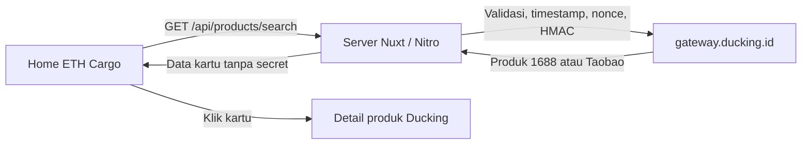

# Alur produk Ducking di Home

Status: implementasi pada `main` per 23 November 2026. Dokumen ini menjelaskan
perilaku kode saat ini; keberhasilan GitHub Action dan respons API di VM tetap
perlu diperiksa setelah push.

## Alur request



Halaman Home memuat hasil awal saat SSR lewat `useFetch`. Pilihan sumber awal
adalah `1688`; keyword kosong pada UI menghasilkan default server `sepatu`.
Pilihan kategori membuka daftar subkategori. Klik subkategori mengirim teks
subkategori sebagai `keyword`. Pencarian manual dan pergantian sumber
memanggil endpoint internal yang sama dari browser.

Browser tidak mengakses gateway Ducking langsung. Ini penting karena setiap
request gateway membutuhkan signature berbasis secret yang hanya boleh ada di
server. Implementasi berada di
[`ProductSourcing.vue`](../apps/web/app/components/marketing/sections/ProductSourcing.vue),
[`search.get.ts`](../apps/web/server/api/products/search.get.ts), dan
[`duckingProducts.ts`](../apps/web/server/utils/duckingProducts.ts).

## Kontrak endpoint internal

`GET /api/products/search` menerima parameter berikut:

| Parameter | Perilaku saat ini |
| --- | --- |
| `source` | Wajib: `1688` atau `taobao`. Lima logo marketplace di UI bersifat visual; sumber pencarian aktif hanya dua ini. |
| `keyword` | Opsional, default `sepatu`; bila diberikan harus berisi 1–100 karakter setelah trim. |
| `page_no` | Default `1`, bilangan bulat 1–100. |
| `page_size` | Default `20`, bilangan bulat 1–50. Home meminta `6`. |

Server meneruskan parameter yang sudah divalidasi ke
`https://gateway.ducking.id/api/v2/products/search`. Host tujuan tetap di kode;
caller tidak dapat menentukan URL gateway. Request memakai timeout 12 detik.
Hasil sukses disimpan di cache memori proses selama 60 detik, maksimal 100 entri.
Cache tidak bertahan saat container mulai ulang dan tidak menyimpan kegagalan.

### Signature

Setiap request yang tidak dipenuhi cache membuat timestamp Unix dalam detik dan
nonce UUID baru. Header yang dikirim ke Ducking adalah `X-Timestamp`, `X-Nonce`,
dan `X-Signature`. Nilai signature berupa HMAC SHA-256 hex lowercase dengan
secret sebagai kunci dan payload:

```text
GET:/api/v2/products/search:<timestamp>:<nonce>:e3b0c44298fc1c149afbf4c8996fb92427ae41e4649b934ca495991b7852b855
```

Hash terakhir adalah SHA-256 body kosong. **Query string tidak masuk payload
signature.** Endpoint pencarian guest tidak memakai Bearer token. Secret dan
header signature tidak dikirim kembali ke browser.

### Respons ke Home

Server membaca `data.products` dari respons Ducking dan menghasilkan
`products`, `pageNo`, `pageSize`, serta `hasMore`. Setiap kartu berisi `id`,
`title`, `image`, `priceIdr`, dan `detailUrl`. Nama terjemahan dipakai bila ada,
diikuti nama asli sebagai fallback. Harga diambil dari `price_idr`; jika tidak
valid, UI menampilkan “Harga tidak tersedia” tanpa menghitung kurs sendiri.
Kartu 1688 menuju detail Ducking dengan `offer_id`; Taobao memakai `item_id`
dan `mi_id` bila tersedia.

Parameter salah menghasilkan HTTP `400`. Secret server yang belum dikonfigurasi
menghasilkan `503`. Kegagalan koneksi, status upstream, atau format respons
menghasilkan `502` dengan pesan aman. Home menampilkan pesan gagal dan tombol
“Coba lagi”.

## Batas UI saat ini

- Home meminta **6 produk halaman pertama**. Awalnya terlihat 3 pada desktop
  dan 2 pada mobile. “Lebih Banyak” membuka sisa dari enam produk itu; saat ini
  tombol tersebut tidak meminta `page_no=2`.
- Saat daftar diperluas, banner CTA sourcing ikut muncul. Teks UI masih
  menyebut tempel link produk, sementara endpoint yang tersedia melakukan
  **pencarian keyword** dan belum mengurai link produk. Jangan menganggap paste
  link atau marketplace selain 1688/Taobao sudah berfungsi.
- `hasMore` tersedia pada respons internal, tetapi belum dipakai oleh Home untuk
  pagination lanjutan.

## Secret dan deployment

Lokal: isi `NUXT_DUCKING_SIGNING_SECRET` di `apps/web/.env`. File tersebut
diabaikan Git; [`apps/web/.env.example`](../apps/web/.env.example) hanya berisi
nama variabel. `nuxt.config.ts` menyimpan `duckingSigningSecret` sebagai runtime
config privat, bukan `public`.

VM: file `/etc/eth-web/ducking-signing-secret` berisi secret yang benar dalam
satu baris, milik `root:root`, mode `0600`. Helper root-owned di
`/usr/local/sbin/deploy-eth-web` membacanya lalu meneruskan
`NUXT_DUCKING_SIGNING_SECRET` melalui Compose web-only. `.env` lokal tidak ikut
Docker image, GitHub push, atau GitHub Action. Pembaruan helper dan Compose di
repository tidak otomatis mengganti salinan root-owned di VM. Lihat
[`deploy/README.md`](../deploy/README.md) untuk prosedur deployment.

Jangan menyalin nilai secret ke dokumen, issue, log, screenshot, atau chat.
Administrator dengan akses Docker di VM dapat membaca environment container,
jadi akses Docker harus tetap terbatas.

## Pemeriksaan setelah deploy

1. Pastikan GitHub Action **Deploy web to VM** sukses dan SHA pada log sesuai
   release yang diharapkan. Healthcheck `/` saja belum menguji produk.
2. Di VM, panggil endpoint lewat Caddy lokal tanpa header signature:

   ```bash
   curl --fail --silent --show-error \
     'http://127.0.0.1:8080/api/products/search?source=1688&keyword=sepatu&page_no=1&page_size=6' \
     | python3 -c 'import json,sys; data=json.load(sys.stdin); print("jumlah produk:", len(data["products"]))'
   ```

3. Buka Home di URL publik. Periksa gambar, judul, harga rupiah, subkategori,
   pergantian 1688/Taobao, dan link detail Ducking.

Jika `503`, periksa keberadaan, owner, dan mode file secret serta apakah
container baru menerima konfigurasi. Jika `502`, cek konektivitas gateway,
secret yang digunakan, waktu VM, serta respons upstream; jangan mencetak
secret atau seluruh environment container. Jika hasil kosong, coba keyword
lain dan cek respons API. Uji kontrak lokal dengan `pnpm --filter web
test:products` dan build dengan `pnpm --filter web build`.
