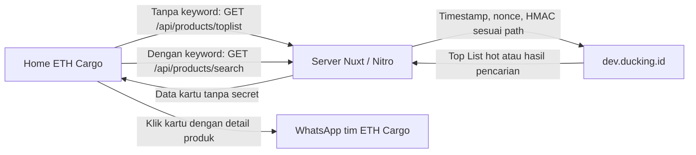

# Alur produk Ducking di Home

Dokumen ini menjelaskan perilaku kode repository saat ini. Keberhasilan GitHub
Action dan respons API di VM tetap perlu diperiksa setelah push.

## Alur request



Section Product Sourcing meminta maksimal enam produk `data.hot.products` dari
`/api/products/toplist` ketika section mulai aktif di dekat viewport. HTML Home
langsung menyertakan section dan skeleton tanpa menunggu respons produk.
Request upstream-nya tetap di server dan memakai
`limit=6&language=en`; tidak ada pencarian `sepatu` saat Home idle. Pilihan sumber
awal adalah `1688`. Ketika input keyword kosong, termasuk setelah pencarian
dikosongkan, Home menggunakan Top List. Jika pilihan marketplace masih Taobao,
daftar idle tetap diberi label produk populer **1688** dan link kartu memakai
sumber 1688, bukan berpura-pura sebagai hasil Taobao.

Pilihan kategori membuka daftar subkategori. Klik subkategori mengirim teks
subkategori sebagai `keyword`. Pencarian manual dengan keyword dan pergantian
sumber saat keyword ada tetap memakai endpoint pencarian lama.
Dropdown Home menampilkan 1688, Taobao, Alibaba, dan AliExpress. Alibaba serta
AliExpress adalah pilihan tampilan yang memakai hasil 1688; hanya Taobao yang
memakai `source=taobao`. Saat keyword kosong, mengganti pilihan tidak meminta
ulang Top List. Pergantian antara 1688/Alibaba/AliExpress saat ada keyword juga
tidak meminta ulang hasil karena sumber efektifnya sama; kartu hanya mendapat
transisi visual singkat (maksimal satu animasi aktif), tanpa request tambahan. Dropdown
terbuka saat hover mouse, sementara tap dan keyboard tetap bisa membuka lewat
tombol. Label hasil dan link produk tetap menunjukkan sumber efektif, bukan
nama pilihan tampilan.

Browser tidak mengakses gateway Ducking langsung. Ini penting karena setiap
request gateway membutuhkan signature berbasis secret yang hanya boleh ada di
server. Implementasi berada di
[`ProductSourcing.vue`](../apps/web/app/components/marketing/sections/ProductSourcing.vue),
[`toplist.get.ts`](../apps/web/server/api/products/toplist.get.ts),
[`search.get.ts`](../apps/web/server/api/products/search.get.ts), dan
[`duckingProducts.ts`](../apps/web/server/utils/duckingProducts.ts).

## Kontrak endpoint internal

`GET /api/products/toplist` tidak menerima parameter dari Home. Server selalu
meminta `https://dev.ducking.id/api/v2/products/toplist/all?limit=6&language=en`,
kemudian hanya membaca `data.hot.products`; daftar `complex` dan `good_price`
tidak ditampilkan. Endpoint pencarian lama **tidak berubah** dan tetap menerima:

| Parameter | Perilaku saat ini |
| --- | --- |
| `source` | Wajib: `1688` atau `taobao`. Dropdown Home berisi empat pilihan, tetapi Alibaba/AliExpress dipetakan ke 1688; lima logo marketplace di UI bersifat visual. |
| `keyword` | Opsional pada endpoint lama, default `sepatu` untuk caller langsung; Home hanya memanggilnya dengan keyword non-kosong (1–100 karakter setelah trim). |
| `page_no` | Default `1`, bilangan bulat 1–100. |
| `page_size` | Default `20`, bilangan bulat 1–50. Home meminta `6`. |

Server meneruskan parameter pencarian yang sudah divalidasi ke
`https://dev.ducking.id/api/v2/products/search`. Host kedua tujuan tetap di
kode; caller tidak dapat menentukan URL gateway. Kedua route memakai timeout
12 detik, cache hasil sukses 60 detik, penggabungan request bersamaan, batas
10 panggilan baru per 60 detik, dan cooldown 60 detik setelah respons `429`.
Cache Top List mempunyai satu entri karena parameternya tetap; cache pencarian
dibatasi 100 entri. Batas kedua route saat ini **terpisah per proses**, bukan
kuota gabungan. Cache tetap dilayani saat pembatasan aktif, kegagalan tidak
di-cache, dan Home tidak melakukan retry otomatis. Beberapa replika memerlukan
pembatas bersama bila batas upstream berlaku secara global.

### Signature

Setiap request yang tidak dipenuhi cache membuat timestamp Unix dalam detik dan
nonce UUID baru. Header yang dikirim ke Ducking adalah `X-Timestamp`, `X-Nonce`,
dan `X-Signature`. Nilai signature berupa HMAC SHA-256 hex lowercase dengan
secret sebagai kunci dan payload:

```text
GET:/api/v2/products/search:<timestamp>:<nonce>:e3b0c44298fc1c149afbf4c8996fb92427ae41e4649b934ca495991b7852b855
GET:/api/v2/products/toplist/all:<timestamp>:<nonce>:e3b0c44298fc1c149afbf4c8996fb92427ae41e4649b934ca495991b7852b855
```

Hash terakhir adalah SHA-256 body kosong. **Query string tidak masuk payload
signature.** Kedua endpoint guest tidak memakai Bearer token. Secret dan
header signature tidak dikirim kembali ke browser.

### Respons ke Home

Untuk Top List, server membaca `data.hot.products` dan memakai `item_id`,
`translate_title` (fallback `title`), `img_url`, serta `sold_out` sebagai jumlah
terjual (hanya jika bilangan bulat nonnegatif). Respons Top List tidak memuat
harga, jadi `priceIdr` bernilai `null`; kartu idle berlabel "Produk Terlaris"
menampilkan jumlah terjual, bukan placeholder harga. Jika jumlah terjual tidak
valid, UI menyatakan datanya belum tersedia. Pesan WhatsApp kartu Top List juga
memakai jumlah terjual, tanpa membuat kurs atau request detail tambahan.
Link referensi 1688 memakai `offer_id`. Untuk pencarian, server tetap membaca
`data.products` dari respons Ducking dan menghasilkan
`products`, `pageNo`, `pageSize`, serta `hasMore`. Setiap kartu berisi `id`,
`title`, `image`, `priceIdr`, dan `detailUrl`. Nama terjemahan dipakai bila ada,
diikuti nama asli sebagai fallback. Untuk pencarian, harga diambil dari
`price_idr`; setelah pencarian kartu menampilkan harga. Jika harga tidak valid,
UI menampilkan “Harga tidak tersedia” tanpa menghitung kurs sendiri.
`detailUrl` mengarah ke detail Ducking dengan `offer_id` untuk 1688, atau
`item_id` dan `mi_id` bila tersedia untuk Taobao. Klik kartu di Home membuka
WhatsApp ETH Cargo, bukan halaman Ducking. Pesan otomatis memuat nama produk,
marketplace, harga referensi untuk pencarian atau jumlah terjual untuk Top List, `detailUrl`
sebagai link referensi, permintaan estimasi impor, dan kode `ETH-WB` di akhir.
Harga referensi bukan biaya impor final.

Parameter pencarian salah menghasilkan HTTP `400`. Secret server yang belum
dikonfigurasi menghasilkan `503`. Batas lokal atau cooldown menghasilkan `429`. Kegagalan
koneksi, status upstream, atau format respons menghasilkan `502` dengan pesan
aman. Home menampilkan pesan gagal dan tombol “Coba lagi”.

## Batas UI saat ini

- Home meminta **6 produk Top List hot** saat idle atau 6 hasil pencarian
  halaman pertama saat ada keyword. Awalnya terlihat 3 pada desktop
  dan 2 pada mobile. “Lebih Banyak” membuka sisa dari enam produk itu; saat ini
  tombol tersebut tidak meminta `page_no=2`.
- Saat daftar diperluas, banner CTA sourcing ikut muncul. Teks UI masih
  menyebut tempel link produk, sementara endpoint yang tersedia melakukan
  **pencarian keyword** dan belum mengurai link produk. Jangan menganggap paste
  link atau API marketplace selain 1688/Taobao sudah berfungsi; Alibaba dan
  AliExpress di dropdown hanya menampilkan hasil 1688.
- `hasMore` tersedia pada respons pencarian internal, tetapi belum dipakai oleh
  Home untuk pagination lanjutan. Top List selalu mengembalikan `hasMore: false`.

## Secret dan deployment

Lokal: isi `NUXT_DUCKING_SIGNING_SECRET` di `apps/web/.env`. File tersebut
diabaikan Git; [`apps/web/.env.example`](../apps/web/.env.example) hanya berisi
nama variabel. `nuxt.config.ts` menyimpan `duckingSigningSecret` sebagai runtime
config privat, bukan `public`.

VM: file `/etc/eth-web/ducking-signing-secret` berisi secret yang benar dalam
satu baris, milik `root:root`, mode `0600`. Helper root-owned di
`/usr/local/sbin/deploy-eth-web` membacanya lalu meneruskan
`NUXT_DUCKING_SIGNING_SECRET` melalui Compose web-only. `.env` lokal tidak ikut
Docker image, GitHub push, atau GitHub Action. Pembaruan helper dan Compose di
repository tidak otomatis mengganti salinan root-owned di VM. Lihat
[`deploy/README.md`](../deploy/README.md) untuk prosedur deployment.

Jangan menyalin nilai secret ke dokumen, issue, log, screenshot, atau chat.
Administrator dengan akses Docker di VM dapat membaca environment container,
jadi akses Docker harus tetap terbatas.

## Pemeriksaan setelah deploy tanpa API produk berbayar

1. Pastikan GitHub Action **Deploy web to VM** sukses dan SHA pada log sesuai
   release yang diharapkan.
2. Periksa healthcheck web melalui `/api/health` dan gateway melalui
   `/favicon-eth.png` setelah konfigurasi baru aktif. Keduanya tidak menguji
   produk Ducking.
3. Jangan panggil `/api/products/search`, `/api/products/toplist`, atau membuka
   Home hanya untuk smoke test produk sampai penggunaan API berbayar diizinkan.
   Browser memicu Top List saat mendekati section Product Sourcing, termasuk
   saat membuka Home langsung pada anchor section. Pemeriksaan gambar, pergantian
   sumber, dan pesan WhatsApp ditunda sampai ada persetujuan untuk panggilan
   produk nyata.

Jika `503`, periksa keberadaan, owner, dan mode file secret serta apakah
container baru menerima konfigurasi. Jika `502`, cek konektivitas gateway,
secret yang digunakan, waktu VM, serta respons upstream; jangan mencetak
secret atau seluruh environment container. Jika hasil kosong, coba keyword
lain dan cek respons API. Uji kontrak lokal dengan
`pnpm --filter web test:products` (fixture, tanpa panggilan Ducking) dan build
dengan `pnpm --filter web build`.
